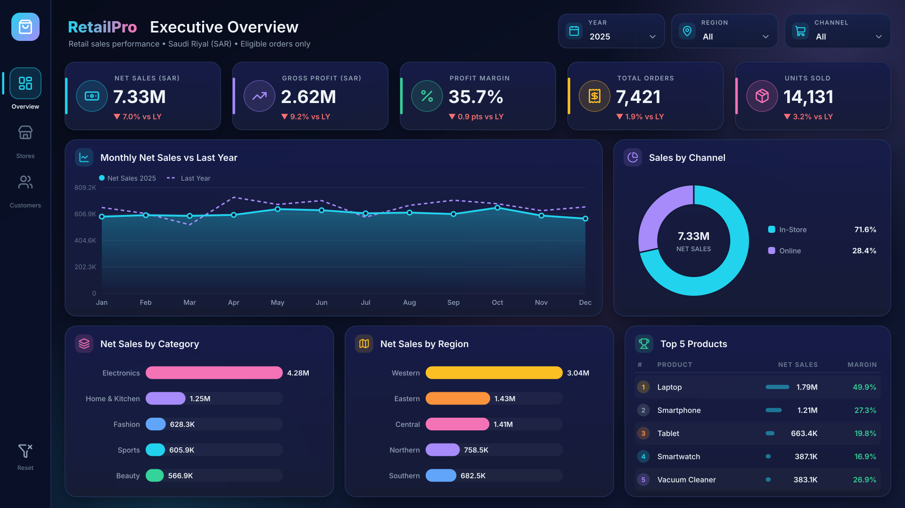
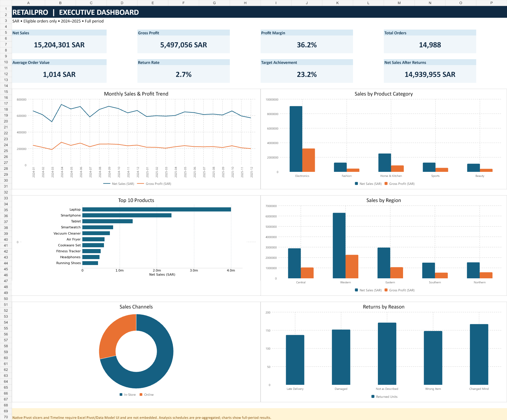
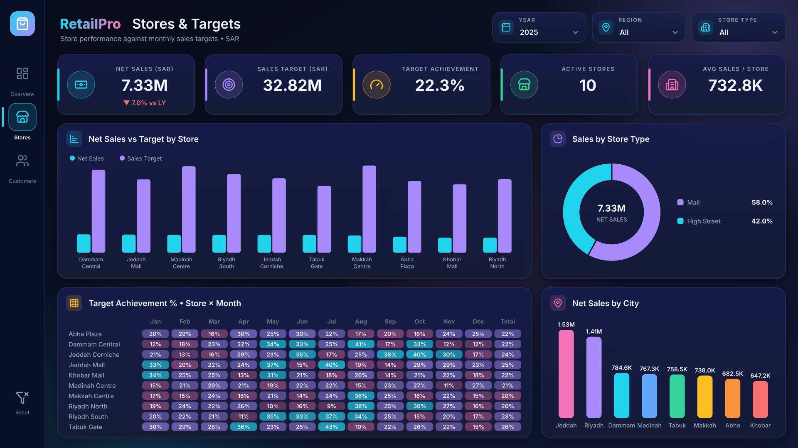
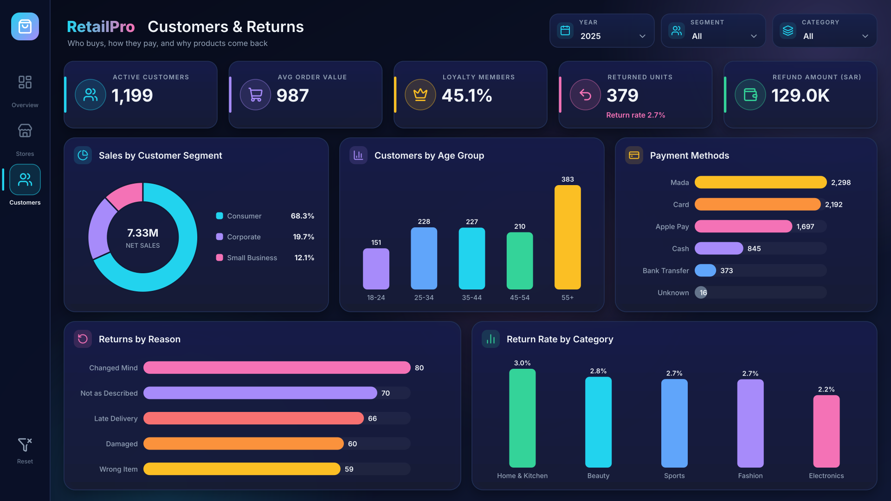

# RetailPro Sales Dashboard

An interactive Power BI dashboard for a multi-store retail business in Saudi Arabia, built on a cleaned and modelled Excel dataset of **15,000 sales transactions** across **10 stores in 8 cities** (2024 - 2025).



## Project goal

Give retail managers one place to answer three questions:

1. **How is the business performing?** Sales, profit, margin and orders, compared with last year.
2. **Which stores are hitting their targets?** Store performance against monthly sales targets.
3. **Who buys, and why do products come back?** Customer segments, payment methods and returns.

## Tools

| Tool | Used for |
|---|---|
| **Excel** | Data profiling, cleaning, data quality flags, Sales_Model preparation, calendar table |
| **Power BI** | Star-schema data model, relationships, report pages, interactivity |
| **DAX** | 35 measures: KPIs, year-over-year, targets, customers and returns |

## Dataset

| Table | Rows | Description |
|---|---:|---|
| Sales_Raw | 15,000 | One row per order line |
| Customers | 1,200 | Customer profile, segment, loyalty membership |
| Products | 25 | Product, category, list price, unit cost |
| Stores | 10 | Store, city, region, store type |
| Returns | 675 | Return reason and refund status |
| Monthly_Targets | 240 | Sales target per store per month |

Full field definitions are in [`docs/Data_Dictionary.md`](docs/Data_Dictionary.md).

## Data preparation (Excel)

- Standardised `SalesChannel` casing (In-Store / Online) and replaced 35 blank payment methods with `Unknown`.
- Kept the 12 rows with zero or negative quantity, flagged them, and excluded them from KPIs through an `EligibleOrders` flag.
- Calculated Gross Sales, Discount, Net Sales, COGS, Gross Profit and Profit Margin per transaction.
- Linked returned units and estimated refund values to the original sales.
- Built a calendar table for 2024 - 2025.
- Built a first summary dashboard in Excel:



## Data model

Star schema with `SalesModel` and `MonthlyTargets` as fact tables:

```
Calendar5  1 ──* SalesModel *── 1 Customers1
Calendar5  1 ──* MonthlyTargets
Stores3    1 ──* SalesModel
Stores3    1 ──* MonthlyTargets
Products2  1 ──* SalesModel
SalesModel 1 ──* Returns4
```

All measures are stored in a dedicated `_Measures` table. See [`powerbi/RetailPro_Measures.dax`](powerbi/RetailPro_Measures.dax).

Example, year-over-year growth that only shows when a single year is selected:

```dax
Net Sales YoY % =
VAR _ly = CALCULATE ( [Net Sales], SAMEPERIODLASTYEAR ( Calendar5[Date] ), REMOVEFILTERS ( Calendar5 ) )
RETURN IF ( HASONEVALUE ( Calendar5[Year] ) && NOT ISBLANK ( _ly ), DIVIDE ( [Net Sales] - _ly, _ly ) )
```

## Dashboard pages

### 1. Executive Overview
KPI cards with year-over-year change, monthly net sales vs last year, sales by channel, category and region, and the top 5 products.

### 2. Stores & Targets
Net sales vs target for every store, a store × month heatmap of target achievement, sales by store type and by city.



### 3. Customers & Returns
Customer segments, age groups, payment methods, return reasons and return rate by category.



### Interactivity
- Year, region, channel, store type, segment and category slicers
- Year slicer synced across pages
- Cross-filtering between all visuals
- Side navigation buttons between pages and a **Reset** button that clears all slicers
- Conditional formatting: green / red year-over-year indicators and a colour-coded target heatmap

## Key insights (2025)

| Metric | Value |
|---|---:|
| Net sales | SAR 7.33M (**-7.0%** vs 2024) |
| Gross profit | SAR 2.62M (-9.2%) |
| Profit margin | 35.7% (-0.9 pts) |
| Orders | 7,421 (-1.9%) |
| Target achievement | **22.3%** |
| Return rate | 2.7% |

- **Electronics** generated SAR 4.28M, more than half of 2025 net sales.
- The **Western** region leads with SAR 3.04M; Jeddah and Riyadh are the top cities.
- **71.6%** of sales came from physical stores, 28.4% online.
- **Target gap:** monthly targets are on average about **4×** actual sales, and no store reached half of its target in any month across 2024 - 2025. This points to a target-setting issue worth reviewing with the business before judging store performance.
- "Changed Mind" was the most frequent return reason in 2025.

More findings and recommendations: [`docs/Business_Insights.md`](docs/Business_Insights.md).

## Repository structure

```
RetailPro_Sales_Dashboard/
├── powerbi/
│   ├── RetailPro_Dashboard.pbix      # Power BI report
│   ├── RetailPro_Measures.dax        # All DAX measures
│   └── RetailPro_Neon_Theme.json     # Report theme
├── excel/
│   └── RetailPro_Project_Tracker.xlsx  # Cleaned data model and analysis
├── data/                             # Original CSV source files
├── docs/                             # Data dictionary and business insights
└── images/                           # Dashboard screenshots
```

## How to open

1. Install [Power BI Desktop](https://powerbi.microsoft.com/desktop/) (free).
2. Download `powerbi/RetailPro_Dashboard.pbix` and `excel/RetailPro_Project_Tracker.xlsx`.
3. Open the `.pbix` file. To refresh the data, point the Excel source to your local copy of the workbook: *Transform data → Data source settings → Change source*.

## Author

**Mohamed Salih**, Data Analyst, Riyadh, Saudi Arabia

[LinkedIn](https://www.linkedin.com/in/mohamed-salih-341bb0368/) · [GitHub](https://github.com/mosalih23-c) · [Portfolio](https://github.com/mosalih23-c/portfolio/)
